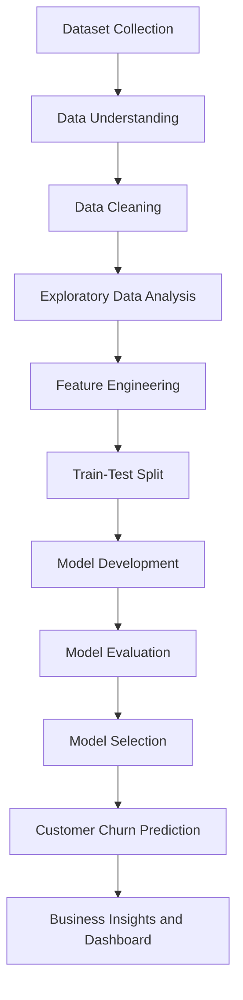

# Customer Churn Prediction & Business Analytics

## Project Overview

An end-to-end Data Analytics and Machine Learning project designed to analyze customer behavior, identify customer churn patterns, predict potential churn and support business retention strategies in the telecom industry.

## Developed By

- Name: Tejaswini Bulbule
- Qualification: Master of Computer Applications (MCA)
- Institute: TechnoSignia Software Training Institute
- Project: Data Analytics and Data Science Internship

## Business Problem

Customer churn is a major challenge for telecom companies because losing existing customers affects recurring revenue and business growth.

This project aims to identify potentially high-risk customers and support proactive customer retention decisions.

## Project Objectives

- Analyze customer behavior and churn patterns.
- Identify important factors associated with churn.
- Perform data cleaning and exploratory data analysis.
- Develop and compare machine learning models.
- Predict potential customer churn.
- Develop interactive business dashboards.
- Provide actionable business recommendations.

## Dataset Overview

The project uses a synthetic telecom customer dataset provided for training purposes.

| Parameter | Value |
|---|---:|
| Total Customers | 8,000 |
| Dataset Columns | 27 |
| Churned Customers | 1,440 |
| Retained Customers | 6,560 |
| Churn Rate | 18% |
| Retention Rate | 82% |
| Missing Values | 464 |
| Duplicate Customer IDs | 0 |
| Training Records | 6,400 |
| Testing Records | 1,600 |

## Tools and Technologies

- Python
- NumPy
- Pandas
- Matplotlib
- Seaborn
- Scikit-learn
- MySQL
- Microsoft Excel
- Microsoft Power BI
- Jupyter Notebook
- Visual Studio Code
- Git and GitHub

## Project Workflow

## Data Preparation

- Missing value identification and imputation
- Duplicate record verification
- Categorical feature encoding
- Numerical feature scaling
- Feature engineering
- Customer ID exclusion from model inputs
- Stratified 80:20 train-test split
- Training-only preprocessing to prevent data leakage

## Exploratory Data Analysis

### Key Business Insights

- Overall customer churn rate is 18%.
- Month-to-month contract customers have a churn rate of 27.83%.
- One-year contract customers have a churn rate of 7.41%.
- Two-year contract customers have a churn rate of 3.72%.
- Customers who raised complaints have a churn rate of 49.42%.
- Customers without complaints have a churn rate of 15.84%.
- Contract type and customer complaints show important associations with churn.

## Machine Learning Models

Three supervised machine learning classification algorithms were implemented:

1. Logistic Regression
2. Decision Tree
3. Random Forest

## Model Performance Comparison

| Metric | Logistic Regression | Decision Tree | Random Forest |
|---|---:|---:|---:|
| Accuracy | 77.00% | 83.38% | 81.38% |
| Precision | 42.16% | 57.86% | 48.60% |
| Recall | 74.65% | 28.13% | 60.07% |
| F1-score | 53.88% | 37.85% | 53.73% |
| ROC-AUC | 85.49% | 78.59% | 83.41% |

## Selected Model: Logistic Regression

Logistic Regression was selected based on its training cross-validation ROC-AUC and suitability for identifying potential churn customers.

The selected model achieved:

- Accuracy: 77.00%
- Precision: 42.16%
- Recall: 74.65%
- F1-score: 53.88%
- ROC-AUC: 85.49%

Recall is particularly important because the business objective is to identify customers who may discontinue services.

## Important Features

Random Forest feature importance analysis identified important predictive features, including:

- Contract Type
- Satisfaction Score
- Total Charges
- Customer Tenure
- Monthly Charges

Feature importance indicates predictive contribution and does not establish causation.

## Example Customer Prediction

| Parameter | Result |
|---|---|
| Customer ID | CUST000956 |
| Predicted Churn Score | 88.43% |
| Predicted Churn | Yes |
| Recommended Action | Retention Review |

The prediction score is not a guarantee of future churn.

## Power BI Dashboard

The project includes business intelligence analysis covering:

- Executive Overview
- Customer Behavior Analysis
- Customer Churn Distribution
- Contract Type Analysis
- Customer Complaint Analysis
- Machine Learning Risk Analysis

## Project Deliverables

- Original Customer Dataset
- Cleaned and Processed Data
- Jupyter Notebooks
- Python Scripts
- Machine Learning Models
- Model Comparison Results
- Confusion Matrices
- ROC Curves
- Feature Importance Analysis
- Power BI Dashboard
- Final Project Report
- Final PowerPoint Presentation
- Presentation Explanation

## Business Recommendations

- Prioritize potentially high-risk customers.
- Improve customer complaint resolution.
- Enhance customer satisfaction and technical support.
- Offer suitable contract renewal benefits.
- Develop targeted customer retention campaigns.

## Project Limitations

- Synthetic training dataset
- Imbalanced target variable
- Possibility of incorrect predictions
- Prediction scores require calibration
- Further real-world validation is required

## Future Scope

- Real-world telecom dataset integration
- Classification threshold optimization
- Prediction score calibration
- Real-time churn prediction
- Streamlit application deployment
- Automated Power BI dashboard updates
- Customer retention campaign evaluation

## Learning Outcomes

- End-to-end Data Analytics
- Data Cleaning and Transformation
- Exploratory Data Analysis
- Feature Engineering
- Machine Learning Classification
- Model Evaluation and Selection
- Predictive Analytics
- Business Intelligence
- Data-Driven Decision Making

## Project Status

Completed as part of the Data Analytics and Data Science Internship.

## Connect With Me

GitHub: https://github.com/winibhadke-cpu

---

Thank you for visiting my project!
